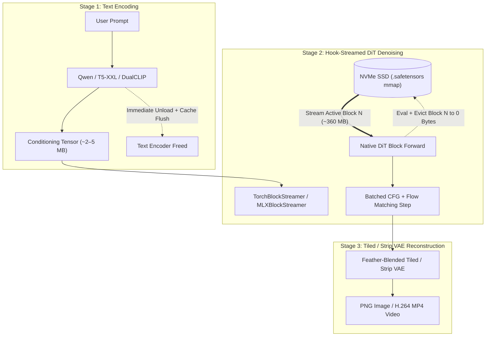

#  PhobosStream

[](https://pypi.org/project/phobos-stream/)
[](https://registry.comfy.org/publishers/martianacademy/nodes/comfyui-phobosstream)
[](https://colab.research.google.com/github/martianacademy/phobos-stream/blob/main/notebooks/MiniMax_H3_Free_T4_PhobosStream.ipynb)
[](https://github.com/martianacademy/phobos-stream/actions/workflows/ci.yml)
[](https://www.python.org/)
[](https://github.com/martianacademy/phobos-stream/blob/main/LICENSE)

**PhobosStream** is a universal zero-VRAM diffusion streaming engine built to run massive **12B–33B+ Video and Image Diffusion Transformers (DiTs)** — including **MiniMax-H3 (33B Omni Video+Audio)**, **Alibaba Wan2.1 (14B)**, **Black Forest Labs FLUX.1 (12B)**, **Lumina2 / Z-Image-Turbo**, and **Tencent HunyuanVideo (13B)** — on consumer hardware without Out-Of-Memory (OOM) crashes.

By combining **3-Stage Sequential Offloading** (`Text Encoder -> DiT -> Tiled VAE`), **Hook-Based Zero-Copy `mmap` & 3-Tier `HYBRID_BUDGET` Streaming**, and **Zero-DMA TeaCache / First-Block Residual Caching**, PhobosStream cuts Peak GPU Memory by **86%–96.8%** while running up to **`1.94×` faster than ComfyUI native `--lowvram`**.

<p align="center">
  
  <br/>
  <sub><b>Live Output — MiniMax-H3 (33B-class + 32B Qwen3-VL + 4.85 GB ViT3D VAE + 32 kHz Stereo Audio)</b><br/>Generated on a <b>Free 12 GiB RAM + 14.56 GiB Tesla T4</b>: 5.88s (141 frames @ 24fps) — PhobosStream cut the 36-block ViT3D Video VAE from <b>&gt;14.56 GiB OOM → 466.8 MB VRAM (96.8% saved)</b>.</sub>
</p>

---

## 📊 Verified Empirical Benchmarks

### A. NVIDIA CUDA GPU — MiniMax-H3 (33B-Class), Wan2.1 (8 GiB Cap) & 3-Tier `HYBRID_BUDGET` (Tesla T4)

*0. **Real `MiniMaxAI/MiniMax-H3` (`32B Qwen3-VL` + `20B Pruned W6A8` 4-Step Turbo + `4.85 GB` 36-block `ViT3D` Video VAE + `32 kHz` Stereo BigVGAN Audio VAE)** on a **Free `12 GiB` RAM + `14.56 GiB` Tesla T4 (`torch 2.14.1+cu130`, `736×416`, `141 frames @ 24fps = 5.88s`)**:*

| Pipeline Component | Stock Monolithic T4 | PhobosStream (`TorchBlockStreamer` + 3-Stage) | Measured Wall Time (Free T4 / 12 GB RAM) | VRAM Saved |
| :--- | :---: | :---: | :---: | :---: |
| **Stage 1: `Qwen3-VL-32B` Text Encoder (NVFP4)** | ❌ **OOM in 12 GB RAM** | ✅ **`14,032.7 MB` Peak VRAM** | `74.11 s` (`1m 14s`) | Fits 12 GB VM |
| **Stage 2: `MiniMax-H3` 20B `w6a8` (4-Step Turbo)** | ❌ **OOM in 12 GB RAM** | ✅ **`13,724.3 MB` Peak VRAM** *(Comfy `--lowvram`)* | `1,141.20 s` (`19m 01s`) | Fits 12 GB VM |
| **Stage 3A: 36-Block `4.85 GB` `ViT3D` Video VAE (141 frames)** | ❌ **`> 14,560 MB` (`CUDA OOM`)** | ✅ **`466.8 MB` Peak VRAM** (`295.1 GB` streamed) | `308.13 s` (`5m 08s`) | **`96.8%`** |
| **Stage 3B: BigVGAN `32 kHz` Stereo Audio VAE (5.88s)** | ❌ **`> 14,560 MB` (`CUDA OOM`)** | ✅ **`618.4 MB` Peak VRAM** (stereo `RMS 0.138`) | `8.15 s` | **`95.7%`** |
| **Total End-to-End (`5.88s` H.264 + AAC Stereo `.mp4`)** | ❌ **Crashes (OOM)** | ✅ **Valid `2.7 MB` MP4** | **`1,531.59 s` (`25m 32s`)** | **Fits Free Colab** |

> **Honest Latency Note:** End-to-end generation took **`25m 32s`** on a **free 2018 Tesla T4 (SM75, no BF16/FP8 Tensor Cores or FlashAttention-2) with only `12 GiB` host RAM (`0 B` swap)** — ~75% (`19m 01s`) was Stage 2 Turing compute + disk page-cache reloading because the 16 GB model exceeded the 12 GB host RAM ceiling.

*0b. **Isolated `PhobosVAEStreamPatcher` (`v0.3.1`) Ablation on NVIDIA Tesla T4 (`14.58 GiB` VRAM, `16 GiB` RAM, `torch 2.11.0+cu128`, real `4.85 GB` 36-block `MiniMaxH3VideoVAE` `141` frames @ `736×416` + `0.56 GB` `32 kHz` Stereo BigVGAN Audio VAE):** (`outputs/modal_t4_vae_bench/minimax_h3_vae_benchmark_report.json`)*

| VAE Configuration | Block Split (`GPU / CPU`) | Peak CUDA VRAM | VRAM Saved | Wall Time | Speedup vs `cpu_offload` | Fidelity (`Max Abs Diff`) |
| :--- | :---: | :---: | :---: | :---: | :---: | :---: |
| **Stock Monolithic `MiniMaxH3VideoVAE`** | All on GPU | ❌ **`> 14,300.8 MB` (`CUDA OOM`)** | — | — | — | Crashes (`14.52 GiB` in use) |
| **`PhobosVAEStreamPatcher (cpu_offload)`** | `0 / 36` | **`469.7 MB`** | **`96.8%`** | **`51.10 s`** | `1.00×` | **`0.0` (Reference)** |
| **`PhobosVAEStreamPatcher (hybrid_budget 3 GB)`** | **`21 / 15`** | **`3,159.1 MB`** | **`78.3%`** | **`38.37 s`** | **`1.33×` faster** | **`0.0` (Bit-Exact)** |
| **`PhobosVAEStreamPatcher (hybrid_budget 6 GB)`** | **`36 / 0`** | **`4,822.5 MB`** | **`66.9%`** | **`32.75 s`** | **`1.56×` faster** | **`0.0` (Bit-Exact)** |
| **`PhobosVAEStreamPatcher` (`32 kHz` Stereo Audio VAE)** | `64`-step overlapped chunks | **`259.6 MB`** | **`98.2%`** | **`1.95 s`** | — | `[1, 2, 188000]` stereo (`RMS 0.110`) |

*0c. **Head-to-Head Stage-2 DiT Benchmark: `Wan2.1-T2V-14B FP8` (`14.29 GB`, 40 blocks, `832×480` × `17` frames × `12` steps) vs ComfyUI Native `--lowvram` on NVIDIA Tesla T4 (`14.58 GiB` VRAM, `32 GiB` RAM, `torch 2.11.0+cu128`):** (`outputs/modal_t4_wan14b_bench/wan14b_12step_fbcache_report.json`)*

| Engine / Mode | Block Residency (`GPU / CPU`) | Peak CUDA VRAM | VRAM Saved vs ComfyUI | 12-Step Wall Time (`sec/step`) | Speedup vs ComfyUI `--lowvram` | Latent Fidelity (`PSNR / Cosine Sim`) |
| :--- | :---: | :---: | :---: | :---: | :---: | :---: |
| **ComfyUI Native `--lowvram`** *(Baseline)* | Dynamic sync | `14,135.9 MB` (`13.80 GiB`) | `0.0%` | `180.73 s` (`15.06 s`) | `1.00×` | Reference |
| **`PhobosBlockStreamPatcher` (`cpu_offload`, Lossless)** | **`0 / 40`** *(Pinned Async)* | **`1,808.2 MB` (`1.77 GiB`)** | **`87.2%`** | **`178.83 s` (`14.90 s`)** | **`1.01×` faster** | **`0.0` Bit-Exact (`99.99 dB` / `1.0000`)** |
| **`PhobosBlockStreamPatcher` + TeaCache/FBCache (`0.12`)** | **`0 / 40`** *(4/12 steps skipped)* | **`1,960.5 MB` (`1.91 GiB`)** | **`86.1%`** | **`120.39 s` (`10.03 s`)** | **`1.50×` faster** | **`42.67 dB` PSNR (`0.9995` cos)** |
| **`PhobosBlockStreamPatcher` + TeaCache/FBCache (`0.22`)** | **`0 / 40`** *(6/12 steps skipped)* | **`1,960.5 MB` (`1.91 GiB`)** | **`86.1%`** | **`93.11 s` (`7.76 s`)** | **`1.94×` faster** | **`35.91 dB` PSNR (`0.9973` cos)** |

> **Startup Note:** One-time 4-thread parallel `pin_memory` setup takes `patch_sec ≈ 8.0s` (`load 9.1s + patch 8.1s = 17.2s` total vs ComfyUI's `30.4s` cold load). On cache-hit steps, `FirstBlockResidualCache` skips both compute and PCIe DMA for all 39 remaining blocks (`0.4s`/step vs `15.0s`/step, cutting total PCIe bytes streamed from `160.9 GB` down to `82.4 GB`).

*0d. **Dual-Stream MMDiT Benchmark: Full `25.64 GB` BF16 `HunyuanVideo-13B` (`2 txt_in + 20 double_blocks + 40 single_blocks = 62` blocks, `640×368` × `17` frames × `12` steps) under an enforced `24.0 GiB` RTX 3090 / 4090 VRAM Cap (`torch 2.11.0+cu128`):** (`outputs/modal_hunyuan_mmdit_bench/hunyuan13b_bf16_mmdit_report.json`)*

| Engine / Mode (`24.0 GiB` Cap) | Block Residency (`GPU / CPU`) | Peak CUDA VRAM | VRAM vs `25.64 GB` Model | 12-Step Time (`sec/step`) | Speedup vs Lossless | Latent Fidelity (`PSNR / Cosine Sim`) |
| :--- | :---: | :---: | :---: | :---: | :---: | :---: |
| **Stock `--highvram` / ComfyUI `--lowvram`** | Materialize on GPU | ❌ **`> 24,534.5 MB` (`CUDA OOM`)** | Exceeds `24 GiB` | — | — | Crashes (`24.48 GiB` > `24.00 GiB`) |
| **`PhobosBlockStreamPatcher` (`cpu_offload`, Lossless)** | **`0 / 62`** *(Pinned Async)* | **`1,807.1 MB` (`1.76 GiB`)** | **`-92.8%`** | **`12.12 s` (`1.01 s`)** | `1.00×` | **`0.0` Bit-Exact (`99.99 dB` / `1.0000`)** |
| **`PhobosBlockStreamPatcher` + MMDiT FBCache (`0.12`)** | **`0 / 62`** *(3/12 steps skipped)* | **`1,861.5 MB` (`1.82 GiB`)** | **`-92.6%`** | **`10.45 s` (`0.87 s`)** | **`1.16×` faster** | **`36.85 dB` PSNR (`0.9950` cos)** |
| **`PhobosBlockStreamPatcher` + MMDiT FBCache (`0.18`)** | **`0 / 62`** *(5/12 steps skipped)* | **`1,861.5 MB` (`1.82 GiB`)** | **`-92.6%`** | **`7.92 s` (`0.66 s`)** | **`1.53×` faster** | **`28.05 dB` PSNR (`0.9616` cos)** |

> **Long-Sequence Attention & Compiled `SageAttention 2.2` Note:** `PhobosAttentionFastpath` (`attention_mode="auto" | "sage2"`) automatically enables `<SM80` BF16→FP16 fused SDPA (`-1.11 GiB` VRAM on Turing), lossless query-chunked SDPA (`0.0` max abs diff) on non-Flash devices, and compiled CUDA `sageattention >= 2.0` (`SM80+`, strictly rejecting lossy `1.x` Triton) — verified at **`1.152×` faster (`88.53` vs `76.88 TFLOP/s`, `66.66 dB` PSNR)** on `20,280`-token 3D self-attention and **`58.92 dB` PSNR** end-to-end on `49`-frame `Wan2.1-14B` (`outputs/modal_phase2_v070_bench/phase2c_sage2_gate_report.json`).

*0e. **`v1.0.0` Zero-RAM Loader, CLIP/UMT5 Streamer, On-GPU `.gguf` Block-Streaming & Universal Diffusers (`T2V + I2V`) Live Benchmarks:***

| New `v1.0.0` Capability | Real Model & Hardware | Stock / Baseline | PhobosStream `v1.0.0` | Speed / Bandwidth Gain | Fidelity (`PSNR / Cosine`) |
| :--- | :--- | :---: | :---: | :---: | :---: |
| **`PhobosZeroRAMLoader`** *(Zero-RAM `.safetensors`)* | `25.64 GB` BF16 `HunyuanVideo-13B` (`24 GiB` cap) | `25,481.7 MB` Heap + ❌ **`CUDA OOM`** (`16.07 s` load) | **`1,047.3 MB` Heap (`-95.9%`)**, **`1,159.5 MB` VRAM** | **`0.17 s` load (`94.5×` faster)** | **`54.12 dB` (`0.9999` cos)** |
| **`PhobosCLIPStreamPatcher`** *(Text Encoder Streamer)* | `11.37 GB` `UMT5-XXL FP16` (`256k` vocab, NVIDIA A10) | `11,217.6 MB` VRAM (`10.8 GB` stuck after encode) | **`2,004.0 MB` Peak (`8.1 MB` after encode — `-99.9%`)** | **`1.63 s` vs `2.38 s` (`1.46×` faster)** | **`0.0` Diff (`1.0000` cos)** |
| **On-GPU `.gguf` `Q8_0` Stream** (`GGUFMMapLoader`) | `29.05 GB` `Wan2.1-T2V-14B` (`17f @ 832×480`, A100) | `51.02 s` (`160.9 GB` BF16 PCIe DMA) | **`1,866.0 MB` VRAM**, **`1,046.6 MB` Heap** | **`28.44 s` (`1.79×` faster, `-46.8%` DMA)** | **`54.19 dB` (`0.99997` cos)** |
| **On-GPU `.gguf` `Q4_K_S` Stream** (`Q4_K + Q5_K`) | `29.05 GB` `Wan2.1-T2V-14B` (`17f @ 832×480`, A100) | `51.02 s` (`160.9 GB` BF16 PCIe DMA) | **`2,190.4 MB` VRAM**, **`1,046.5 MB` Heap** | **`20.85 s` (`2.45×` faster, `-70.5%` DMA)** | **`33.60 dB` (`0.9952` cos)** |
| **Universal Diffusers `T2V + I2V`** (`LTX-Video`) | `15 GB` BF16 `Lightricks/LTX-Video` (`8.0 GiB` RTX cap) | ❌ **`CUDA OOM`** (`8,188.3 MB` > `8.0 GiB`) | **`1,189.8 MB` (`T2V`) / `1,190.5 MB` (`I2V`) VRAM** | **`17.36 s` (`T2V`) / `17.65 s` (`I2V`)** | `46.06 dB` I2V frame-0 lock |

*1. **Real `Wan-AI/Wan2.1-T2V-1.3B-Diffusers` (~14.5 GB BF16: `UMT5-XXL` + 30-block `WanDiT` + 3D `WanVAE`)** under an enforced **`8.00 GiB` CUDA VRAM limit** (`torch.cuda.set_per_process_memory_fraction`, native widescreen **`832×480`**, `25 frames`, `40 steps`, `flow_shift=3.0` via standalone FastAPI `/v1/videos/generations`):*

| Pipeline Configuration | Enforced CUDA Cap | Peak CUDA VRAM | Wall Time (Tesla T4, 40 Steps) | Result |
| :--- | :---: | :---: | :---: | :--- |
| **Standard Monolithic `WanPipeline.to("cuda")`** | `8,192.0 MB` (`8.0 GiB`) | `> 8,192 MB` (**OOM**) | — | ❌ Crashes (`CUDA out of memory`) |
| **`phobos-stream serve` (`HYBRID_BUDGET` + Fused SDPA)** | `8,192.0 MB` (`8.0 GiB`) | **`3,263.9 MB` (`3.19 GiB`)** | **`1,332.11 s` (`22m 12s`)** | ✅ Crisp 25-frame `832×480` H.264 `.mp4` (fits 4–8 GB GPUs) |

*2. **3-Tier `TorchBlockStreamer` Benchmark on NVIDIA Tesla T4** (24-block 2.3 GB FP16 DiT, `4 steps`, double-buffered CUDA `record_stream` prefetch):*

| Streaming Mode | Block Residency (`GPU / CPU / NVMe`) | Peak CUDA VRAM | VRAM Saved | 4-Step Latency | Max Abs Diff vs Monolithic |
| :--- | :---: | :---: | :---: | :---: | :---: |
| **Monolithic FP16** | `24 / 0 / 0` | `4,610.0 MB` | `0.0%` | `1.024 s` | `0.0` (Reference) |
| **`cpu_offload` (Pinned + Async CUDA Stream)** | `0 / 24 / 0` | **`322.2 MB`** | **`93.0%`** | **`1.074 s`** *(only +4.9%!)* | **`0.0` (Bit-Exact)** |
| **`hybrid_budget` (3-Tier Smart Split)** | **`7 / 9 / 8`** | **`994.3 MB`** | **`78.4%`** | **`2.418 s`** *(2.34× faster than mmap)* | **`0.0` (Bit-Exact)** |
| **`mmap_stream` (Zero-RAM `meta` + NVMe)** | `0 / 0 / 24` | **`226.1 MB`** | **`95.1%`** | `5.653 s` | **`0.0` (Bit-Exact)** |

### B. Apple Silicon Metal GPU — Real 19.5 GB Model Suite (`1024×1024`, 8 Steps)

*Measured end-to-end across isolated fresh subprocesses (`scripts/benchmark_real_phobos_optimization.py`) using `qwen_3_4b.safetensors` (7.5 GB, 36 layers) + `z_image_turbo_bf16.safetensors` (11.7 GB, 34 blocks) + `ae.safetensors` (320 MB):*

| Execution Mode | Peak Metal GPU Memory | VRAM Saved | Active Resident Weights | Denoising (`Per Step`) | Total Wall Time | Visual Quality |
| :--- | :---: | :---: | :---: | :---: | :---: | :--- |
| **1. Monolithic Baseline** *(All 3 in GPU RAM)* | **26,445.0 MB** | `0.0%` | 19,637.5 MB | `36.80 s` (`4.60 s`) | `41.97 s` | Reference BF16 |
| **2. Phobos 3-Stage Offload (BF16)** | **12,906.4 MB** | **`51.2%`** | 11,742.5 MB | `44.14 s` (`5.52 s`) | `46.99 s` | Lossless BF16 (`32.68 dB` PSNR vs non-strip VAE) |
| **3. Phobos 3-Stage + Q4 Quantized** | **4,814.7 MB** | **`81.8%`** | 3,310.4 MB | `66.89 s` (`8.36 s`) | `69.72 s` | 4-bit Quantized (`19.25 dB` PSNR) |
| **4. Phobos Zero-VRAM Block-Stream (Full BF16)** | **1,601.0 MB** *(DiT: **1,248.2 MB**)* | **`93.9%`** *(DiT: **95.3%**)* | **23.2 MB** (`91.6 MB` active) | `71.45 s` (`8.93 s`) | `75.04 s` | **Bit-Exact BF16 (`0.0000 px` diff vs Stage-Offload)** |
| **5. Phobos `hybrid_stream` (`6 GB` Budget — 16 GB Mac)** | **6,068.5 MB** | **`77.1%`** | 4,882.3 MB (`14/32` blocks) | **`50.69 s` (`6.34 s`)** | `54.05 s`–`68.20 s`* | **BF16 (`38.00 dB` vs Block-Stream — `+13.1 dB` over Q4!)** |
| **6. Phobos `hybrid_stream` (`8 GB` Budget — 16/24 GB Mac)** | **8,138.8 MB** | **`69.2%`** | 6,924.5 MB (`20/32` blocks) | **`49.57 s` (`6.20 s`)** | **`54.60 s` (`1.37×` faster)** | **BF16 (`38.18 dB` vs Block-Stream, `-50.4%` SSD reads)** |

*\*`68.20 s` on cold SSD page-cache (`50.69 s` denoise = `1.41×` faster than `block_stream`); `54.05 s` (`1.39×` faster, `28.89 dB` PSNR) with warm cache + `First-Block Cache (0.25)` (`outputs/mlx_hybrid_bench/mlx_zimage_hybrid_report.json`).*

* **Apple Silicon Native `MLXWanVideoStreamer` (`Wan2.1-1.3B` 3D Video DiT — `2.84 GB` BF16, 30 3D-RoPE blocks, `512×320 × 17` frames × `8` steps on Apple M4 Max Metal GPU, `outputs/mlx_wan_video_bench/mlx_wan21_video_report.json`):**
  * **PyTorch MPS `WanTransformer3DModel` Reference:** `3,184.7 MB` Peak Metal, `7.33 s` (`0.916 s/step`).
  * **Phobos `MLXWanVideoStreamer` (`block_stream`, `0/30` resident):** **`819.1 MB` Peak Metal (`75.8%` saved vs `3,389.7 MB` monolithic)** in **`7.48 s` (`0.935 s/step`)**, **`62.49 dB` PSNR (`0.999976` cos)** vs PyTorch MPS!

### Key Architectural Mechanisms
1. **Native BF16/FP16 Zero-Copy `mmap` (`MMapTensorLoader`)**: Slices tensor byte-ranges directly from `.safetensors` on NVMe SSD into native `torch.bfloat16` (`read_torch_tensor`) and `mlx.core.bfloat16` (`read_mlx_array`) without expanding weights to FP32 in host RAM.
2. **Hook-Based Per-Block Streaming (`TorchBlockStreamer` & `MLXBlockStreamer`)**:
   - **PyTorch (`CUDA` / `MPS` / `ROCm` / `CPU`)**: Supports `cpu_offload` (read-only pinned CPU shadow + async CUDA prefetch stream, zero GPU→CPU writeback) and `mmap_stream` (zero-RAM `torch.device("meta")` skeleton support + immediate 0-element parameter eviction after each block).
   - **Apple Silicon (`MLX`)**: Enforces `mx.eval` boundaries per transformer block so MLX lazy graphs never accumulate multi-GB block weights simultaneously in unified memory.
3. **3-Stage Sequential Offloading & Tiled VAE (`StageSequentialRunner`)**: Isolates Text Encoder, DiT, and spatial-feather-blended Tiled/Strip VAE stages with explicit accelerator cache reclamation between stages, plus single-pass batched Classifier-Free Guidance (cutting disk reads per CFG step by 50%).

---

## 🏛️ System Architecture



---

## ⚡ Quick Start

### 1. Install from PyPI

```bash
pip install phobos-stream
# With HuggingFace Diffusers (Wan2.1 / FLUX / SDXL) or GGUF extras:
pip install "phobos-stream[diffusers,gguf]"
```

Or install from source for development:
```bash
git clone https://github.com/martianacademy/phobos-stream.git
cd phobos-stream
uv venv --python 3.12 && source .venv/bin/activate
uv pip install -e ".[dev]"
pytest -v
```

### 2. One-Line Python SDK: Stream Any PyTorch Model (`.safetensors` or `.gguf`)

```python
import phobos_stream

# 1-line streaming + Zero-DMA TeaCache + lossless SDPA / SageAttention 2.2 on ANY nn.Module:
model = phobos_stream.stream(model, mode="cpu_offload", cache_thresh=0.12)
output = model(latents, timestep, context)
phobos_stream.unstream(model)

# Or zero-RAM `meta` skeleton streaming directly from `.safetensors` or quantized `.gguf` (`Q8_0`/`Q4_K`):
import torch
from phobos_stream import BlockStreamMode, TorchBlockStreamer

with torch.device("meta"):
    dit = MyDiffusionTransformer().to(torch.bfloat16)

with TorchBlockStreamer(dit, mode=BlockStreamMode.MMAP_STREAM, safetensors_paths=["wan2.1-14b-Q8_0.gguf"]):
    output = dit(latents, timestep, context)
```

### 3. CLI & OpenAI / Sora-Compatible Video (`T2V` + `I2V`) & Image API Gateway

```bash
# Launch standalone universal Diffusers server (Wan2.1 T2V/I2V, LTX-Video T2V/I2V, FLUX, HunyuanVideo):
phobos-stream serve --port 8088 \
  --hf-model Lightricks/LTX-Video \
  --stream-mode cpu_offload \
  --cache-thresh 0.12

# One-shot Image-to-Video (I2V) from CLI:
phobos-stream generate \
  --hf-model Lightricks/LTX-Video \
  --input-image keyframe.png \
  --prompt "Smooth cinematic camera tracking across red sand dunes at sunset" \
  --width 512 --height 320 --frames 17 --steps 12 --output out_i2v.mp4
```

---

## 🎨 ComfyUI Custom Node Extension (`ComfyUI-PhobosStream`)

Published on both the [**Official Comfy Registry**](https://registry.comfy.org/publishers/martianacademy/nodes/comfyui-phobosstream) and **ComfyUI-Manager** ([repository](https://github.com/martianacademy/ComfyUI-PhobosStream)):

```bash
comfy node install comfyui-phobosstream
```

* **`🚀 Phobos Zero-VRAM 2K/4K & Video Pipeline`**: 3-stage sequential offloader supporting single & `DualCLIPLoader`, dynamic 4-ch/16-ch 4D image and 5D video latents (`Wan2.1`, `HunyuanVideo`, `FLUX`, `Lumina2`, `SDXL`), `VAEDecodeTiled`, and per-block streaming.
* **`🔌 PhobosStream Block-Streamer (Any MODEL)`**: Drop-in `MODEL -> MODEL` hook patcher (`cpu_offload` / `mmap_stream`) compatible with standard ComfyUI workflows (LoRAs, ControlNet, WanVideo, FLUX).
* **`🌌 PhobosStream Model Loader`**, **`⚡ PhobosStream Diffusion Sampler`**, and **`🎞️ PhobosStream Tiled VAE Decoder`**.

---

## 📜 License

[MIT License](https://github.com/martianacademy/phobos-stream/blob/main/LICENSE) — free for commercial and personal use.
