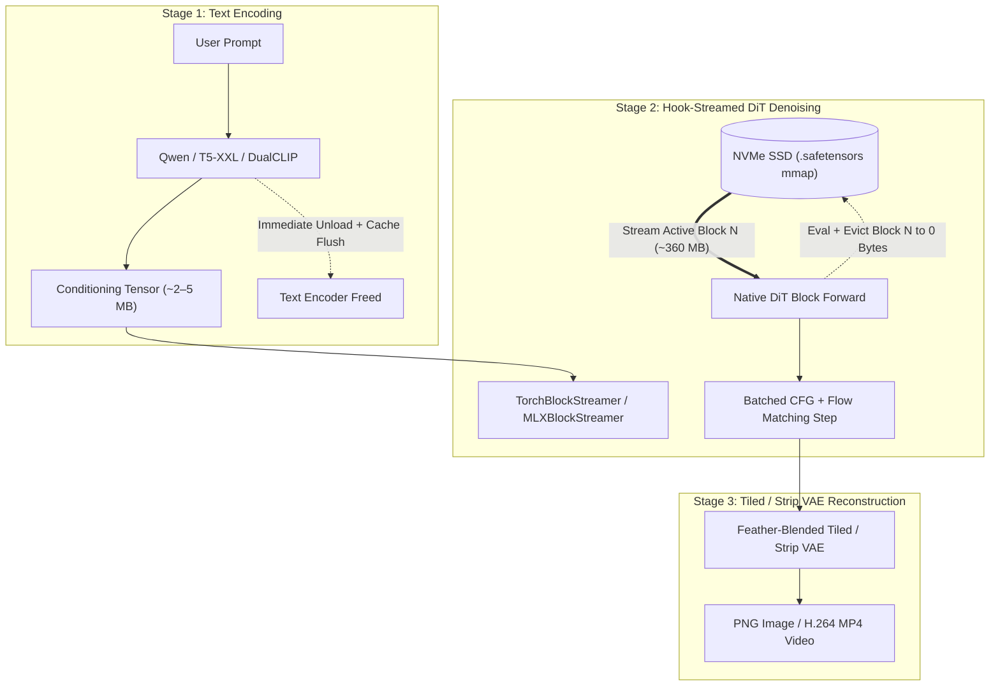

# PhobosStream 🌌

[](https://opensource.org/licenses/MIT)
[](https://www.python.org/)
[]()
[]()

**PhobosStream** is a universal zero-VRAM diffusion streaming engine designed to run massive **12B–20B+ Video and Image Diffusion Transformers (DiTs)** — including **Alibaba Wan2.1 (14B)**, **Black Forest Labs FLUX.1 (12B)**, **Lumina2 / Z-Image-Turbo**, and **Tencent HunyuanVideo (13B)** — on consumer hardware without Out-Of-Memory (OOM) crashes.

By combining **3-Stage Sequential Offloading** (`Text Encoder -> DiT -> Tiled VAE`) with **Hook-Based Zero-Copy `mmap` Block-by-Block Streaming** (`TorchBlockStreamer` & `MLXBlockStreamer`), PhobosStream cuts Peak GPU Memory on a real **19.5 GB BF16 pipeline from 26.45 GB down to 1.25–1.60 GB (93.9%–95.3% VRAM reduction)** with **zero quantization quality loss**.

---

## 📊 Verified Empirical Benchmarks (Real 19.5 GB Model Suite)

*Measured end-to-end on Apple Silicon Metal GPU across isolated fresh subprocesses (`scripts/benchmark_real_phobos_optimization.py`) using `qwen_3_4b.safetensors` (7.5 GB, 36 layers) + `z_image_turbo_bf16.safetensors` (11.7 GB, 34 blocks) + `ae.safetensors` (320 MB) at `1024 × 1024`, `8 steps`, `seed=42`:*

| Execution Mode | Peak Metal GPU Memory | VRAM Saved | Active Resident Weights | Denoising (`Per Step`) | Total Wall Time | Visual Quality |
| :--- | :---: | :---: | :---: | :---: | :---: | :--- |
| **1. Monolithic Baseline** *(All 3 in GPU RAM)* | **26,445.0 MB** | `0.0%` | 19,637.5 MB | `36.80 s` (`4.60 s`) | `41.97 s` | Reference BF16 |
| **2. Phobos 3-Stage Offload (BF16)** | **12,906.4 MB** | **`51.2%`** | 11,742.5 MB | `44.14 s` (`5.52 s`) | `46.99 s` | Lossless BF16 (`32.68 dB` PSNR vs non-strip VAE) |
| **3. Phobos 3-Stage + Q4 Quantized** | **4,814.7 MB** | **`81.8%`** | 3,310.4 MB | `66.89 s` (`8.36 s`) | `69.72 s` | 4-bit Quantized (`19.25 dB` PSNR) |
| **4. Phobos Zero-VRAM Block-Stream (Full BF16)** | **1,601.0 MB** *(DiT: **1,248.2 MB**)* | **`93.9%`** *(DiT: **95.3%**)* | **23.2 MB** (`91.6 MB` active) | `71.45 s` (`8.93 s`) | `75.04 s` | **Bit-Exact BF16 (`0.0000 px` diff vs Stage-Offload)** |

### Key Architectural Mechanisms
1. **Native BF16/FP16 Zero-Copy `mmap` (`MMapTensorLoader`)**: Slices tensor byte-ranges directly from `.safetensors` on NVMe SSD into native `torch.bfloat16` (`read_torch_tensor`) and `mlx.core.bfloat16` (`read_mlx_array`) without expanding weights to FP32 in host RAM.
2. **Hook-Based Per-Block Streaming (`TorchBlockStreamer` & `MLXBlockStreamer`)**:
   - **PyTorch (`CUDA` / `MPS` / `ROCm` / `CPU`)**: Supports `cpu_offload` (read-only pinned CPU shadow + async CUDA prefetch stream, zero GPU→CPU writeback) and `mmap_stream` (zero-RAM `torch.device("meta")` skeleton support + immediate 0-element parameter eviction after each block).
   - **Apple Silicon (`MLX`)**: Enforces `mx.eval` boundaries per transformer block so MLX lazy graphs never accumulate multi-GB block weights simultaneously in unified memory.
3. **3-Stage Sequential Offloading & Tiled VAE (`StageSequentialRunner`)**: Isolates Text Encoder, DiT, and spatial-feather-blended Tiled/Strip VAE stages with explicit accelerator cache reclamation between stages, plus single-pass batched Classifier-Free Guidance (cutting disk reads per CFG step by 50%).

---

## 🏛️ System Architecture



---

## ⚡ Quick Start

### 1. Installation

```bash
git clone https://github.com/martianacademy/phobos-stream.git
cd phobos-stream

uv venv --python 3.12
source .venv/bin/activate
uv pip install -e ".[dev]"
```

### 2. Run Test Suite (27 Unit & Integration Tests)

```bash
pytest -v
```

### 3. Python API: Hook Any Real PyTorch DiT in 4 Lines

```python
import torch
from phobos_stream.streaming import BlockStreamMode, TorchBlockStreamer

with torch.device("meta"):
    model = MyDiffusionTransformer().to(torch.bfloat16)

with TorchBlockStreamer(
    model,
    compute_device="auto",
    mode=BlockStreamMode.MMAP_STREAM,
    safetensors_paths=["model_bf16.safetensors"],
):
    output = model(latents, timestep, context)
```

### 4. Launch OpenAI / Sora-Compatible REST & WebSocket API

```bash
phobos-stream serve --port 8088 --manifest-path shards/manifest.json --backend auto
```

---

## 🎨 ComfyUI Custom Node Extension (`ComfyUI-PhobosStream`)

**ComfyUI-PhobosStream** is registered in **ComfyUI-Manager** ([standalone repository](https://github.com/martianacademy/ComfyUI-PhobosStream)) and works out-of-the-box with zero unpublished dependencies:

* **`🚀 Phobos Zero-VRAM 2K/4K & Video Pipeline`**: 3-stage sequential offloader supporting single & `DualCLIPLoader`, dynamic 4-ch/16-ch 4D image and 5D video latents (`Wan2.1`, `HunyuanVideo`, `FLUX`, `Lumina2`, `SDXL`), `VAEDecodeTiled`, and per-block streaming.
* **`🔌 PhobosStream Block-Streamer (Any MODEL)`**: Drop-in `MODEL -> MODEL` hook patcher (`cpu_offload` / `mmap_stream`) compatible with standard ComfyUI workflows (LoRAs, ControlNet, WanVideo, FLUX).
* **`🌌 PhobosStream Model Loader`**, **`⚡ PhobosStream Diffusion Sampler`**, and **`🎞️ PhobosStream Tiled VAE Decoder`**.

---

## 📜 License

MIT License — free for commercial and personal use.
