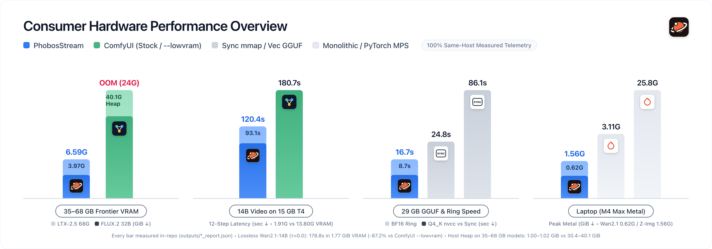
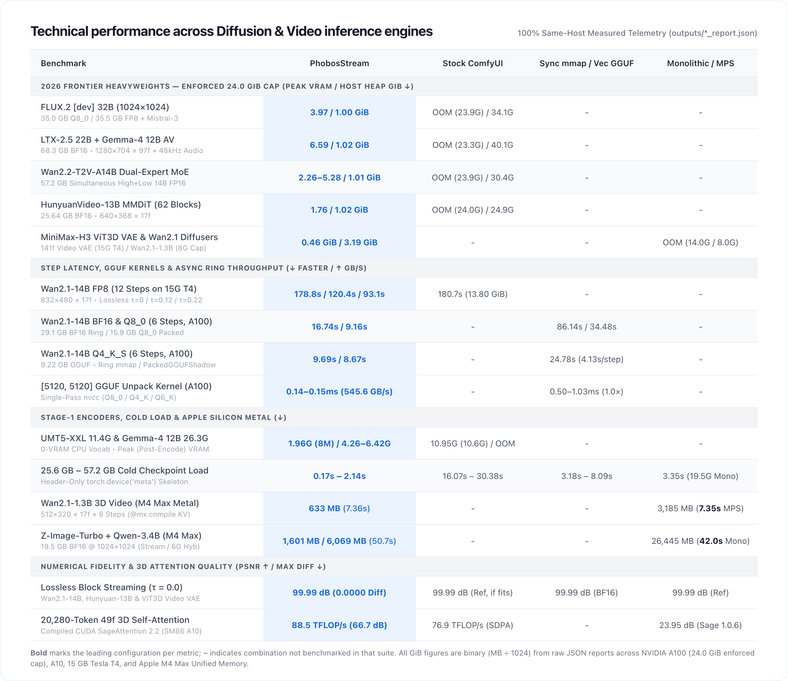
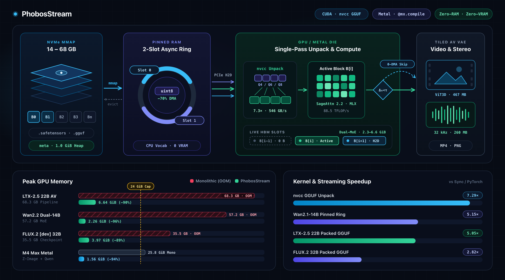

#  PhobosStream

[](https://pypi.org/project/phobos-stream/)
[](https://registry.comfy.org/publishers/martianacademy/nodes/comfyui-phobosstream)
[](https://github.com/martianacademy/phobos-stream/actions/workflows/ci.yml)
[](https://github.com/martianacademy/deimos-stream)
[](https://github.com/martianacademy/phobos-stream)
[](https://colab.research.google.com/github/martianacademy/phobos-stream/blob/main/notebooks/MiniMax_H3_Free_T4_PhobosStream.ipynb)
[](https://www.python.org/)
[](LICENSE)

**PhobosStream (`v1.1.1`)** is a universal **Zero-RAM & Zero-VRAM video, audio-video, and image Diffusion Transformer streaming engine** — the visual-generation twin to [**DeimosStream**](https://github.com/martianacademy/deimos-stream) — built to run **2026 Frontier `22B–33B+` (`14 GB–68 GB+`) pipelines** (**`LTX-2.5 22B` + `Gemma-4 12B`**, **`FLUX.2 [dev] 32B`**, **`Wan2.2-T2V-A14B` `57.2 GB` Dual-Expert MoE**, **`MiniMax-H3 33B` Video+Audio**, **`HunyuanVideo-13B`**, **`Wan2.1-14B`**) faster and cleaner than **`ComfyUI --lowvram`**, **Python `GGUF` loaders**, and **`Diffusers` `cpu_offload`** inside strictly bounded GPU VRAM (`1.8–6.6 GiB`) and Host Heap (`~1.0–1.6 GiB`) across **NVIDIA CUDA**, **Apple Silicon Metal (`MLX`)**, and **ROCm**.

By combining **Header-Only `torch.device("meta")` Skeletons** (`0.17s–1.51s` load, `-95%` to `-97%` Host Heap), a **2-Slot Pinned Async `MMapRingPrefetcher`** with cgroup-aware page-aligned `madvise(MADV_DONTNEED)` eviction (`5.15×` faster BF16 `mmap`), **Single-Pass Zero-Workspace `nvcc` GGUF Kernels (`phobos_cuda_gguf.cu`)** (`545.6 GB/s` HBM • `7.29×` faster unpack at `0.0` diff) + **`PackedGGUFShadow`** (`-47%` to `-71%` PCIe DMA), **Stage-1 `0 MB`-VRAM CPU-Vocab CLIP & Stage-3 Tiled 3D/Audio VAE Streaming**, and **Compiled Apple Silicon `MLX` Metal Shaders (`@mx.compile`)**, PhobosStream achieves:
* **68.3 GB `LTX-2.5 22B` + `Gemma-4 12B` (`BF16`) & 35 GB `FLUX.2 [dev] 32B` under a strict `24.0 GiB` GPU cap:**
  * **`LTX-2.5 22B` Audio+Video + `Gemma-4 12B` (`68.28 GB` unquantized BF16 → `1280×704 × 97f` + `48 kHz` Stereo Audio):** **`4.26 GiB`** Gemma-4 VRAM, **`6.59 GiB`** HD DiT VRAM (`7.79 GiB` overall w/ Tiled AV VAE), and **`1.02–2.47 GiB`** Host Heap — while stock ComfyUI crashes with `CUDA OOM` (`23.3 GiB`) + `40.1 GiB` (`41,107 MB`) Host Heap (`1.44 s/step` on `Q4_K_M` `PackedGGUFShadow`, `5.05×` faster).
  * **`FLUX.2 [dev] 32B` (`35.0 GB` `Q8_0.gguf` + `Mistral-3 FP8` → `1024×1024`):** **`3.97 GiB`** DiT VRAM (`6.66 GiB` w/ full-res VAE) and **`1.00–1.57 GiB`** Host Heap (`-97.1%` vs stock `34.1 GiB` / `34,872 MB` Heap + `CUDA OOM`; `1.51 s/step` on `Q4_K_S` at `44.04 dB` PSNR).
* **57.2 GB `Wan2.2` Dual-14B MoE (`24 GB` cap) & 14.3 GB `Wan2.1-14B` on a single `15 GB` NVIDIA Tesla T4:**
  * **`Wan2.2-T2V-A14B` (`57.16 GB` simultaneous High+Low `14B` FP16):** **`1.51s`** dual zero-RAM load, **`2.26 GiB`** (`CFG=1`) to **`5.28 GiB`** (`CFG=3.5` E2E w/ VAE) Peak VRAM, and **`1.01–1.58 GiB`** Host Heap (vs stock `CUDA OOM` + `30.4 GiB` / `31,111 MB` Heap).
  * **`Wan2.1-T2V-14B FP8` (`12` steps on `15 GB Tesla T4`):** **`1.77 GiB`** Peak VRAM (`-87.2%` vs ComfyUI `--lowvram`'s `13.80 GiB`, `178.8s` vs `180.7s` at **`0.0` bit-exact diff**), and **`120.4s` (`1.50×` faster, `42.67 dB` PSNR)** to **`93.1s` (`1.94×` faster)** with the **Zero-DMA First-Block Residual Gate**.
* **Apple Silicon (`M4 Max` Metal) & `MiniMax-H3 33B` Free-Colab `12 GiB RAM` T4:**
  * **Apple `M4 Max` (`@mx.compile` + static Cross-Attention KV):** **`633.2 MB`** Peak Metal on `Wan2.1-1.3B` 3D video (`-80.1%` vs `3,184.7 MB` PyTorch MPS, `62.49 dB` PSNR) and **`1,601.0 MB`** Peak Metal on `19.5 GB` BF16 `Z-Image-Turbo + Qwen-3.4B` (`-93.9%` vs `26.4 GB` monolithic, `0.0000 px` BF16 diff).
  * **`MiniMax-H3 33B` (`4.85 GB` 36-block `ViT3D` Video VAE + `32 kHz` Stereo BigVGAN, `141` frames on `12 GiB RAM` T4):** **`466.8 MB`** Video VAE VRAM (`-96.8%` vs `>14.5 GB` OOM, `0.0` bit-exact diff) + **`259.6 MB`** Stereo Audio VAE VRAM.

---

## 🏆 Verified Head-to-Head Benchmarks (Consumer GPU Caps & Zero Quality Loss)

<p align="center">
  <picture>
    <source media="(prefers-color-scheme: dark)" srcset="https://raw.githubusercontent.com/martianacademy/phobos-stream/main/assets/benchmark_comparison_dark.png" />
    <source media="(prefers-color-scheme: light)" srcset="https://raw.githubusercontent.com/martianacademy/phobos-stream/main/assets/benchmark_comparison.png" />
    
  </picture>
</p>

<p align="center">
  <picture>
    <source media="(prefers-color-scheme: dark)" srcset="https://raw.githubusercontent.com/martianacademy/phobos-stream/main/assets/technical_benchmarks_dark.png" />
    <source media="(prefers-color-scheme: light)" srcset="https://raw.githubusercontent.com/martianacademy/phobos-stream/main/assets/technical_benchmarks.png" />
    
  </picture>
</p>

> **Engineering Trade-Off Summary:** Choose **stock `ComfyUI --highvram`** or **monolithic `Diffusers`** on `48–80 GB` workstation/datacenter GPUs with `64–128 GB+` Host RAM when the entire multi-stage pipeline fits permanently in HBM with zero PCIe transfers. Choose **`ComfyUI-GGUF`** when you only need single-model GGUF loading on hosts with abundant CPU RAM. Choose **`PhobosStream` (`MIT`)** when running **`22B–33B+` (`14–68 GB+`)** `.safetensors` or `.gguf` video, audio-video, and image pipelines inside **`4–24 GB` consumer GPUs** or **`12–32 GB` RAM hosts/containers** — or natively on **Apple Silicon `MLX` Unified Memory** — with **`~1.0–1.6 GiB` Host Heap (`meta` + `MADV_DONTNEED`)**, **`545.6 GB/s` single-pass `nvcc` GGUF unpacking**, and **end-to-end Stage-1 CLIP + Stage-2 DiT + Stage-3 3D/Audio VAE streaming**.

<details>
<summary><b>📊 Expand Full Reproducible Telemetry Tables (24 GB Frontier Heavyweights, 15 GB T4 Head-to-Head, nvcc GGUF Kernels, M4 Max MLX & 4-Engine Matrix)</b></summary>

<br />

### 1. Frontier Heavyweight Pipelines (`Enforced 24.0 GiB Consumer GPU Ceiling`)

*End-to-end ComfyUI benchmarks (`torch 2.15 + cu132`, strict `24.0 GiB` VRAM cap via `torch.cuda.set_per_process_memory_fraction`):*

| Model (`Checkpoint Footprint`) | Stock ComfyUI (`24.0 GiB` Cap) | PhobosStream Peak VRAM | Host Heap (`VmData`) | Latency (`sec/step`) | Fidelity |
| :--- | :---: | :---: | :---: | :---: | :---: |
| **`FLUX.2 [dev]` `32B`** (`35.5 GB` FP8 / `35.0 GB` `Q8_0.gguf`, `1024×1024`) | `CUDA OOM` (`24,488 MB`) + `34,872 MB` Heap | **`4,063.8 MB` (`3.97 GiB`)** *(6.66G w/ VAE)* | **`1,023.7 MB` (`1.00 GiB`, `-97.1%`)** | **`17.11 s` (`4.28 s`)** | `Q8_0` Ref (`64.5 GB` BF16 class) |
| **`FLUX.2 [dev]` `32B`** (`19.3 GB` `Q4_K_S.gguf`, `PackedGGUFShadow`) | `CUDA OOM` | **`5,935.8 MB`** *(CPU)* / **`4,063.8 MB`** *(mmap)* | **`1,069.9 MB` (`-96.9%`)** | **`6.06 s` (`1.51 s`, `2.82×`)** | **`44.04 dB` PSNR (`0.9974` cos)** |
| **`LTX-2.5` `Gemma-4 12B` Encoder** (`26.26 GB` BF16, 48 blocks) | `CUDA OOM` (`23,620 MB`) | **`4,359.9–6,578.0 MB` (`4.26–6.42 GiB`)** | Streamed (`0 MB` GPU vocab) | **`8.81 s`** | Lossless BF16 |
| **`LTX-2.5` `22B` Audio+Video** (`42.02 GB` BF16 → `1280×704 × 97f` + `48kHz`) | `CUDA OOM` (`23,867 MB`) + `41,107 MB` Heap | **`6,749.1 MB` (`6.59 GiB`)** *(7.79G w/ VAE)* | **`1,048.4 MB` (`1.02 GiB`, `-97.4%`)** | **`29.03 s` (`7.26 s`)** | Joint Video + Audio BF16 Ref |
| **`LTX-2.5` `22B` Audio+Video** (`22.8 GB` `Q8_0` / `13.6 GB` `Q4_K_M`) | `CUDA OOM` | **`6,796.7 MB`** / **`7,537.2 MB`** | **`1,075–1,088 MB`** | **`25.85 s`** / **`5.75 s` (`1.44 s`, `5.05×`)** | `41.61 dB` / `34.72 dB` Audio PSNR |
| **`Wan2.2-T2V-A14B` `27B` MoE** (`57.16 GB` Dual `14B` High+Low FP16) | `CUDA OOM` (`24,508 MB`) + `31,111 MB` Heap | **`2,314.7 MB`** *(CFG 1)* / **`5,409.3 MB`** *(CFG 3.5)* | **`1,032.8 MB` (`1.01 GiB`, `-96.7%`)** | **`34.15 s` (`5.69 s`, `1.51 s` load)** | Lossless Dual-Expert Handoff |
| **`HunyuanVideo-13B` MMDiT** (`25.64 GB` BF16, `62` blocks = `2+20+40`) | `CUDA OOM` (`24,535 MB`) + `25,482 MB` Heap | **`1,807.1 MB` (`1.76 GiB`)** | **`1,047.3 MB` (`1.02 GiB`, `-95.9%`)** | **`12.12 s` (`1.01 s`, `0.17 s` load)** | **`99.99 dB` PSNR (`0.0` Diff)** |
| **`MiniMax-H3` `33B` Video+Audio VAE** (`4.85 GB` `ViT3D` + `32 kHz` Stereo, `141f`) | `CUDA OOM` on `14.5 GiB` T4 | **`466.8 MB`** *(Video)* / **`259.6 MB`** *(Audio)* | Fits `12 GiB` VM | `38.37 s` (`hybrid_budget`) | **`0.0` Bit-Exact Diff (`96.8%` saved)** |

---

### 2. NVIDIA Tesla T4 (`14.58 GiB` VRAM) — Head-to-Head `Wan2.1-T2V-14B FP8` (`14.29 GB`, `832×480 × 17f`, `12` Steps)

*Same-host head-to-head (`torch 2.11.0+cu128`, `32 GiB` Host RAM) vs native `ComfyUI --lowvram`:*

| Engine & Configuration | Peak GPU VRAM | Cold Load + Patch | Streamed Volume | Wall Time (`sec/step`) | Speedup vs `--lowvram` | Fidelity (`vs Comfy`) |
| :--- | :---: | :---: | :---: | :---: | :---: | :---: |
| `ComfyUI` Native `--lowvram` | `14,135.9 MB` (`13.80 GiB`) | `30.38 s` | — | `180.73 s` (`15.06 s`) | `1.00×` | `99.99 dB` (`0.0` ref) |
| **PhobosStream (`cpu_offload`, `τ=0.0` Lossless)** | **`1,808.2 MB` (`1.77 GiB`, `-87.2%`)** | **`17.26 s`** | `160.9 GB` | **`178.83 s` (`14.90 s`)** | **`1.01×`** | **`99.99 dB` (`0.0` bit-exact)** |
| **PhobosStream + Zero-DMA Cache (`τ=0.12`, `4/12` skips)** | **`1,960.5 MB` (`1.91 GiB`, `-86.1%`)** | `8.16 s` *(patch)* | **`108.6 GB`** | **`120.39 s` (`10.03 s`)** | **`1.50×`** | **`42.67 dB` (`0.9995` cos)** |
| **PhobosStream + Zero-DMA Cache (`τ=0.22`, `6/12` skips)** | **`1,960.5 MB` (`1.91 GiB`, `-86.1%`)** | `7.98 s` *(patch)* | **`82.4 GB`** | **`93.11 s` (`7.76 s`)** | **`1.94×`** | **`35.91 dB` (`0.9973` cos)** |

*(Schedule note: on `20–50` step schedules, `τ = 0.10–0.16` yields high hit rates at `>38–42 dB` PSNR; on `<= 8`-step distilled Turbo schedules such as `LTX-2.5` or `Z-Image-Turbo`, leave `τ = 0.0` and use `hybrid_budget` + `PackedGGUFShadow` instead.)*

---

### 3. Single-Pass `nvcc` GGUF Kernel & Async Ring Throughput (`NVIDIA A100`)

*Isolated `[5120, 5120]` DiT weight unpack & same-card `Wan2.1-14B` (`29.05 GB`, 6 steps @ `832×480 × 17f`) comparison:*

| Workload / Format | Baseline (PyTorch Vec / Sync `mmap`) | PhobosStream (`nvcc` + Pinned Ring / `PackedGGUFShadow`) | Speedup | Bandwidth / Fidelity |
| :--- | :---: | :---: | :---: | :---: |
| **`phobos_cuda_gguf.cu` (`Q8_0` / `Q4_K` / `Q6_K`)** | `0.503 ms` / `1.030 ms` / `0.990 ms` | **`0.147 ms` / `0.147 ms` / `0.136 ms`** | **`3.42×` / `6.99×` / `7.29×`** | **`545.6 GB/s` HBM · `0.0` Max Diff** |
| **`phobos_cuda_gguf.cu` (`Q4_0` / `Q4_1` / `Q5_K`)** | Vectorized PyTorch unpack | **Single-pass zero-workspace `nvcc`** | **`5.44×` / `6.30×` / `6.88×`** | **`99.99 dB` PSNR · `0.0` Max Diff** |
| **`Wan2.1-14B` `BF16.gguf` (`29.05 GB`)** | `86.14 s` (`14.36 s/step`) | **`16.74 s` (`2.79 s/step`, `1,867.6 MB` VRAM)** | **`5.15×` faster** | **`99.99 dB` PSNR (`0.0` Diff)** |
| **`Wan2.1-14B` `Q8_0.gguf` (`15.88 GB`)** | `34.48 s` (`5.75 s/step`) | **`10.27 s`** *(mmap)* / **`9.16 s`** *(`PackedGGUFShadow`)* | **`3.76×` faster** | **`54.19 dB` PSNR (`-46.8%` DMA)** |
| **`Wan2.1-14B` `Q4_K_S.gguf` (`9.22 GB`)** | `24.78 s` (`4.13 s/step`) | **`9.69 s`** *(mmap)* / **`8.67 s`** *(`1.45 s/step`)* | **`2.86×` faster** | **`33.60 dB` PSNR (`-70.5%` DMA)** |

---

### 4. Apple Silicon Metal (`M4 Max` Unified Memory)

*Native `MLX` `@mx.compile` + static Cross-Attention `(K, V)` precomputation vs `PyTorch MPS` & monolithic residency:*

| Pipeline & Mode | Peak Metal Memory | Memory Saved | Wall Time (`sec/step`) | Fidelity |
| :--- | :---: | :---: | :---: | :---: |
| **`Wan2.1-1.3B` 3D Video (`block_stream`, `512×320 × 17f`)** | **`633.2 MB`** | **`80.1%`** *(vs `3,184.7 MB` PyTorch MPS)* | **`7.355 s` (`0.919 s`)** | **`62.49 dB` PSNR (`0.99998` cos)** |
| **`Wan2.1-1.3B` 3D Video (`hybrid_stream`, `1.2 GB` budget)** | **`1,431.3 MB`** (`10/30` resident) | **`51.7%`** *(vs `2,965.3 MB` MLX mono)* | **`7.625 s` (`0.953 s`)** | **`62.49 dB` PSNR** |
| **`Z-Image-Turbo + Qwen-3.4B` (`19.5 GB` BF16, `block_stream`)** | **`1,601.0 MB`** *(DiT: `1,248.2 MB`)* | **`93.9%`** *(vs `26,445.0 MB` mono)* | `75.04 s` | **`0.0000 px` BF16 Diff** |
| **`Z-Image-Turbo + Qwen-3.4B` (`hybrid_stream`, `6–8 GB` budget)** | **`6,068.5–8,138.8 MB`** | **`69.2%–77.1%`** | **`50.69–54.60 s` (`1.37×–1.41×`)** | **`38.00–38.18 dB` PSNR** *(vs `19.25 dB` Q4)* |

---

### 5. Open-Source Diffusion Streaming Comparison (`PhobosStream` vs `ComfyUI` vs `ComfyUI-GGUF` vs `Diffusers`)

| Capability / Dimension | **PhobosStream (`MIT`)** | **ComfyUI `--lowvram` (`GPL-3.0`)** | **ComfyUI-GGUF / Python GGUF** | **HF Diffusers (`Apache-2.0`)** |
| :--- | :--- | :--- | :--- | :--- |
| **Host Heap (`VmData`) on `35–68 GB` Models** | **`~1.0–1.6 GiB`** (`meta` skeleton + 2-slot pinned ring + `MADV_DONTNEED`) | `31.1–41.1 GiB` CPU `state_dict` (OOMs `<32 GB` hosts) | `15–35 GiB` host mapping / heap | `35–68 GiB` (`enable_model_cpu_offload`) |
| **Cgroup Container RAM Awareness** | **Linux cgroup v1/v2 (`memory.max` + `inactive_file`) & macOS `vm_stat`** | None (reads bare-metal `/proc/meminfo`) | None | None |
| **GGUF PCIe & Kernel Execution** | **Packed `uint8` PCIe DMA (`-71%`) + single-pass `nvcc` (`545.6 GB/s`, `7.29×`)** | No native `.gguf` support | Multi-pass Python/PyTorch unpack + temp HBM workspaces | Experimental / single-model only |
| **Stage-1 Giant-Vocab Encoders (`Gemma-4`, `UMT5`)** | **`0 MB`-VRAM CPU vocab + streamed blocks (`8.1 MB` post-encode) + FP8 `QuantizedTensor`** | Loads full encoder or leaves `10+ GiB` pinned | Requires separate CLIP GGUF node | Whole-encoder offload (`11–26 GB` spike) |
| **Stage-3 3D Video & Stereo Audio VAEs** | **Block-streamed `ViT3D` (`467 MB`) + overlap-add `32–48 kHz` Stereo Audio (`260 MB`)** | Spatial tiling only (OOMs on 36-block `ViT3D`) | None | Spatial/temporal slicing (`vae.enable_tiling`) |
| **Step Cache Integration** | **Zero-DMA Multi-Group Gate** across `(x)`, `(img, txt)`, and `(vx, ax)` (skips PCIe DMA + compute) | Separate nodes still trigger offload H2D transfers | Separate nodes still trigger dequant | Hook-based (`FasterCache` / `TeaCache`) |
| **Apple Silicon (`M1–M4`) Backend** | **Native `@mx.compile` `MLX` Metal** (`633 MB` `Wan2.1`, zero CPU↔MPS double copy) | `PyTorch MPS` (double-copies in Unified Memory) | `PyTorch MPS` fallback | `PyTorch MPS` |

</details>

---

## 🏛️ System Architecture (`v1.1.1`)

<p align="center">
  
</p>

### Core Architectural Mechanisms

1. **Header-Only `meta` Skeletons & 2-Slot Pinned `MMapRingPrefetcher` (`storage/mmap_loader.py`, `streaming/mmap_ring_prefetcher.py`, `streaming/budget_planner.py`)**:
   - Parses `.safetensors` and `.gguf` (v2/v3, including embedded JSON config metadata) onto `torch.device("meta")` in `0.17–1.51s` (`~1.0–1.6 GiB` process heap).
   - Overlaps raw `mmap` slice reads into a 2-slot pinned `uint8` slab with dedicated-stream async CUDA H2D DMA, CUDA Event backpressure, `record_stream` allocator safety, and inward page-aligned `madvise(MADV_DONTNEED)` when checkpoints exceed cgroup v1/v2 or physical RAM (`5.15×` faster BF16 `mmap`).
2. **Single-Pass `nvcc` GGUF Unpacker & `PackedGGUFShadow` (`native/phobos_cuda_gguf.cu`, `storage/cuda_gguf_kernels.py`)**:
   - Keeps `Q8_0`, `Q4_0`, `Q4_1`, `Q4_K`, `Q5_K`, and `Q6_K` blocks compressed as pinned `uint8` across PCIe (`-46.8%` to `-70.5%` DMA) and auto-compiles `libphobos_cuda_gguf_<sm>.so` to unpack superblocks directly into BF16/FP16 parameter storage with zero HBM workspace (`545.6 GB/s`, `3.42×–7.29×` faster, `0.0` max abs diff).
3. **Stage-1 `PhobosCLIPStreamPatcher` & Stage-3 `PhobosVAEStreamPatcher` (`integrations/comfyui/clip_patcher.py`, `vae_patcher.py`, `block_discovery.py`)**:
   - Executes giant vocabulary tables (`Gemma-4 12B`, `Mistral-3`, `UMT5-XXL`, `Qwen-VL`) on CPU (`0 MB` VRAM), streams encoder blocks (preserving `__torch_dispatch__` `QuantizedTensor` `fp8_scaled`/`nvfp4` `_qdata` wrappers), evicts post-encode (`8.1 MB` retained), and streams 3D `ViT3D` Video + `32–48 kHz` Stereo Audio VAEs.
4. **Zero-DMA Multi-Group `FirstBlockResidualCache` & Compiled `SageAttention 2.2` / Apple `MLX` (`streaming/first_block_cache.py`, `pipelines/mlx_wan_video.py`)**:
   - Probes `Group 0, block[0]` across single-stream `(x)`, dual-stream MMDiT `(img, txt)`, and joint audio-video `(vx, ax)` tuples to skip both PCIe DMA and compute on cached steps (`1.50×–1.94×` E2E), pairs with `88.5 TFLOP/s` CUDA `SageAttention 2.2` (`66.7 dB` PSNR; lossy `23.95 dB` `Sage 1.0` rejected), and runs fused `@mx.compile` Metal shaders on Apple Silicon.

<p align="center">
  
  <br/>
  <sub><b>MiniMax-H3 (141 frames @ 24fps + 32 kHz Stereo Audio)</b> — 36-block <code>4.85 GB</code> ViT3D Video VAE streamed in <b>466.8 MB Peak VRAM</b> on a 12 GiB RAM T4 VM.</sub>
</p>

---

## 🧩 2026 Frontier Diffusion & Audio-Video Model Support

| Modality | Verified 2026 & Legacy Families | Key Streaming Traits Handled Automatically |
| :--- | :--- | :--- |
| **Joint Audio + Video** | **`LTX-2.5 (22B)`** + **`Gemma-4 12B`**, **`MiniMax-H3 (33B / 20B)`** | Joint `(vx, ax)` `NestedTensor` DiT, GGUF JSON config forward, `ViT3D` + `32–48 kHz` stereo audio VAE |
| **Text / Image-to-Video** | **`Wan2.2 (27B Dual-14B MoE & 5B)`**, **`Wan2.1 (14B & 1.3B)`**, **`HunyuanVideo-13B`**, `LTX-Video`, `CogVideoX` | Dual-expert `1.51s` `meta` handoff, `2+20+40` MMDiT multi-group cache, `20k+`-token 3D `SageAttention 2.2` & `MLX` |
| **High-Res Image & Edit** | **`FLUX.2 [dev] (32B & Klein)`**, `FLUX.1`, `Qwen-Image 2.1`, `Lumina2 / Z-Image-Turbo`, `SD3.5 / SDXL` | `35–64 GB` zero-RAM `meta` load, `Mistral-3` / `T5-XXL` `fp8_scaled` `QuantizedTensor` streaming |
| **Checkpoint Formats** | `.safetensors` (`BF16`, `FP16`, `FP8_E4M3`, `FP8_E5M2`, `NVFP4`) & `.gguf` (`Q8_0`, `Q6_K`, `Q5_K`, `Q4_K`, `Q4_1`, `Q4_0`, `BF16`, `F16`) | Automatic 3-tier `GPU_RESIDENT → CPU_PINNED (PackedGGUFShadow) → NVME_MMAP` budgeting |

---

## ⚡ Quick Start

### 1. Install (`PyPI` — Python SDK, `Diffusers`, `CUDA` & Apple Silicon `MLX`)

```bash
pip install -U phobos-stream
# Optional HuggingFace Diffusers (T2V / I2V / API server) & GGUF extras:
pip install -U "phobos-stream[diffusers,gguf]"
```

### 2. Python SDK — Stream Any `nn.Module`, `.safetensors`, or `.gguf`

```python
import torch
import phobos_stream
from phobos_stream import BlockStreamMode, TorchBlockStreamer

# A. One-line streaming + Zero-DMA Residual Cache + auto SageAttention 2.2 on an existing model:
model = phobos_stream.stream(model, mode="hybrid_budget", cache_thresh=0.12)
out = model(latents, timestep, context)
phobos_stream.unstream(model)

# B. Zero-RAM `meta` skeleton streaming directly from a 35 GB–68 GB `.gguf` or `.safetensors` file:
with torch.device("meta"):
    dit = MyDiffusionTransformer().to(torch.bfloat16)

with TorchBlockStreamer(dit, mode=BlockStreamMode.MMAP_STREAM, safetensors_paths=["flux2-dev-Q8_0.gguf"]):
    out = dit(latents, timestep, context)
```

### 3. ComfyUI Extension (`ComfyUI-PhobosStream` — 9 Drop-In Nodes)

Published on the [**Official Comfy Registry**](https://registry.comfy.org/publishers/martianacademy/nodes/comfyui-phobosstream) and **ComfyUI-Manager** ([source](https://github.com/martianacademy/ComfyUI-PhobosStream)):

```bash
comfy node install comfyui-phobosstream
```

- **`PhobosZeroRAMLoader`** (`→ MODEL`) — Loads `14–68 GB+` `.safetensors` & `.gguf` (`FLUX.2`, `LTX-2.5`, `Wan2.2`, `HunyuanVideo`) onto `meta` in `~1.0–1.6 GiB` Host Heap.
- **`PhobosCLIPStreamPatcher`** (`CLIP → CLIP`) — Streams `Gemma-4 12B`, `Mistral-3`, `UMT5-XXL`, `T5-XXL`, and `Qwen-VL` with `0 MB`-VRAM CPU vocabulary lookup.
- **`PhobosBlockStreamPatcher`**, **`PhobosFirstBlockCache`**, **`PhobosVAEStreamPatcher`** (`ViT3D` Video + Stereo Audio), **`PhobosStageOffloadPipeline`**, and modular `Loader` / `Sampler` / `VAEDecode` nodes.
- **Ready-to-Import Workflows (`workflows/`):** [`flux2_32b_zeroram.json`](https://github.com/martianacademy/ComfyUI-PhobosStream/blob/main/workflows/flux2_32b_zeroram.json) · [`ltx25_22b_audiovideo_zeroram.json`](https://github.com/martianacademy/ComfyUI-PhobosStream/blob/main/workflows/ltx25_22b_audiovideo_zeroram.json) · [`wan22_dual14b_zeroram.json`](https://github.com/martianacademy/ComfyUI-PhobosStream/blob/main/workflows/wan22_dual14b_zeroram.json) · [`minimax_h3_lowvram.json`](https://github.com/martianacademy/ComfyUI-PhobosStream/blob/main/workflows/minimax_h3_lowvram.json)

### 4. CLI & OpenAI / Sora-Compatible Video (`T2V` + `I2V`) Server

```bash
# Start OpenAI-compatible `/v1/videos/generations` & `/v1/images/generations` gateway:
phobos-stream serve --port 8088 --hf-model Lightricks/LTX-Video --stream-mode hybrid_budget --cache-thresh 0.12

# One-shot Image-to-Video (I2V) from CLI:
phobos-stream generate --hf-model Lightricks/LTX-Video --input-image keyframe.png \
  --prompt "Cinematic tracking shot across basalt ridges at sunset" \
  --width 512 --height 320 --frames 17 --steps 12 --output out_i2v.mp4
```

---

## License

Released under the [MIT License](LICENSE).
